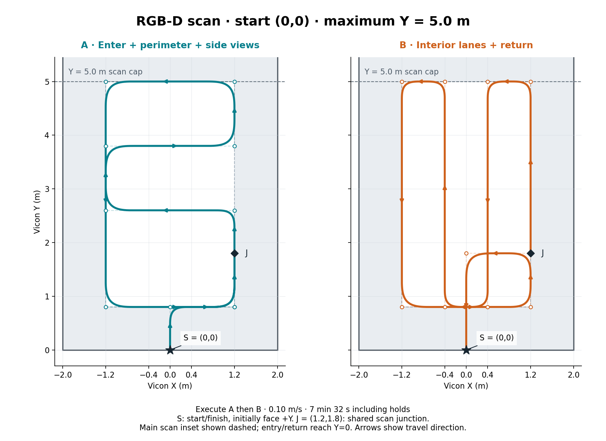

# RGB-D Vicon scan starting at the measured position

This route uses the operator-provided Vicon limits `x=[-2,2]`, `y=[0,10] m`
and a D455 rigidly attached to the base, looking in the driving direction.
The trajectory uses offsets extending **5.0 m along +Y from the captured start**.
It starts and finishes at the measured starting position; there is no absolute
start-position tolerance and no initial command to drive to the world origin.
It is a coverage-oriented capture route for RTAB-Map, not a certification that
every surface is visible. No obstacle layout was supplied.

The executable profile is
[`rgbd_vicon_scan.yaml`](../reference_trajectory/config/rgbd_vicon_scan.yaml).
It uses the existing continuous-waypoint planner and hardware controller.
Coordinates are **offsets from the accepted starting XY**, expressed along
Vicon world axes. The path translates but does not rotate with the robot.
Start near the intended origin with raw Vicon base yaw **0 rad**, facing **+Y**.
The position gate is inactive in `start_translated_vicon` mode. Stationarity,
yaw (within 0.15 rad), Vicon freshness and geometric validity checks remain.
For start `(x0,y0)`, the placed reference bounds are `X=[x0-1.2,x0+1.2]`,
`Y=[y0,y0+5.0]`. Check the whole translated footprint before starting.
For the reported start `(0.025,-0.074)`, these are X=[-1.175,1.225] m and
Y=[-0.074,4.926] m. A positive starting Y would put the endpoint beyond world
Y=5; the previous absolute Y=5 cap is no longer enforced by route placement.



The diagram shows the nominal zero-origin placement. Translate all plotted
coordinates by the captured start; it is not a live world-position preview.

## Route and purpose

Execute A then B as one continuous run. In offset coordinates, `S=(0,0)` is
the captured start/finish and `J=(1.2,1.8)` is the shared scan junction.

**A — entry from the origin, then perimeter with a crosswise excursion:**

```text
S → (0,0.8) → (1.2,0.8) → J
  → (1.2,2.6) → (-1.2,2.6) → (-1.2,3.8) → (1.2,3.8)
  → (1.2,5.0) → (-1.2,5.0) → (-1.2,0.8) → (1.2,0.8) → J
```

**B — interior lanes, a revisit of J, and return to the origin:**

```text
J → (1.2,5.0) → (0.4,5.0) → (0.4,0.8) → (-0.4,0.8)
  → (-0.4,5.0) → (-1.2,5.0) → (-1.2,0.8) → (1.2,0.8)
  → J → (0,1.8) → S
```

The four longitudinal lanes are 0.8 m apart. The crosswise legs at Y=2.6 and
3.8 add views toward both sides. Repeated outer legs approach previously seen
structure from the same direction, providing opportunities for visual loop
closure. B revisits J travelling +Y through familiar views, then returns to S
along -Y. The final base heading is not commanded to equal its initial heading.
Opposite-facing lane images are not assumed to match each other.

RTAB-Map recognizes revisited appearances and uses accepted loop closures to
correct its graph; returning to similar camera views is therefore useful.
See the [RTAB-Map project overview](https://introlab.github.io/rtabmap/).

The existing XY controller lets chassis heading emerge from motion. Its
`fixed_yaw_rad` is a turret reference, not a camera/base-heading command.
Connected bends encourage forward turning; an exact reverse could instead
drive backwards while the camera keeps facing the same way. This route avoids
such immediate reversals. The plot arrows indicate travel direction, not
guaranteed camera orientation. Confirm actual views during the capture.

## Speed, clearance and coverage limits

| Setting | Value |
| --- | --- |
| Nominal translation speed | 0.10 m/s |
| Corner deviation bound | 0.10 m; corners are blended, not stopped at |
| Reference offsets from start | X=[-1.2,1.2], Y=[0.0,5.0] m |
| Nominal scan side/bottom inset | 0.8 m at zero-origin placement; shifts with start |
| Blended path length | 43.018 m (unrounded waypoints: 45.6 m) |
| Planned motion duration | 7 min 12.1 s |
| Initial/final stationary holds | 10 s each |
| Total after accepted start | **7 min 32.1 s** |

The plotted margins apply to the reference point at nominal zero placement,
**not the outside of the vehicle**. Entry/return reach the captured start.
All margins change with its translation; allow clearance for the full robot.
Confirm that the whole rotating chassis/caster envelope plus tracking error
fits, and clear every leg of obstacles. This waypoint runner
does not use depth for obstacle avoidance and does not enforce a workspace
geofence. Smaller objects inside the rectangle require route changes.

At 0.10 m/s, the current 2 Hz RTAB-Map detection setting sees about 5 cm of
straight travel per update. Capture all configured 30 Hz RGB/depth images;
processing rate can be adjusted on replay. The ideal controller model gives
`|base yaw rate| <= speed / 0.301`, about 0.332 rad/s (19 degrees/s) at cruise;
this is not a measured limit on feedback corrections or actual rotation.

RealSense specifies an ideal D455-family operating range of 0.6–6 m. Prefer
useful textured structure roughly 1–3 m away where practical; the nominal
10 m arena length does not mean the camera can see its whole length at once.
Actual usable view depends on resolution, calibration, depth validity and
surface properties. See the [manufacturer specification](https://www.realsenseai.com/product-family/450-series/).

This is a planar navigation-map capture. A fixed-height, fixed-pitch camera
cannot guarantee coverage of ceilings, high shelves, undersides or occluded
surfaces. Inspect the reconstructed cloud and add views for holes. Camera
height/pitch should include stable scene features as well as the required floor;
do not assume the launch's simulated 20-degree pitch is the real mount.

## Preview without moving hardware

Build the updated reference package once, then source the workspace in each
terminal:

```bash
source /opt/ros/jazzy/setup.bash
source /home/hamr/hamster_ws/install/setup.bash
cd /home/hamr/hamster_ws
colcon build --packages-select reference_trajectory hamr_bringup compa_slam
source /home/hamr/hamster_ws/install/setup.bash
```

The node update keeps dense samples in `--plan-only` output but omits them from
live metadata, and prepares visualization poses before arming. For the original
10-minute route before its Y cap was reduced,
serializing dense metadata alone took about 256 ms on the preparation host;
constructing the visualization poses took another 83 ms. Doing that after arming
would exceed the unchanged 80 ms watchdog. Compact live metadata and cached
poses remove that route-size-dependent startup work without relaxing the guards.
A synthetic start of that original full route on an isolated localhost ROS domain took
11.6 ms after the change and produced a valid first reference decision. That
checks startup overhead on this host; it is not a timing guarantee under live
camera, DDS and storage load.

Preview the exact source profile:

```bash
ros2 run reference_trajectory continuous_waypoint \
  --config /home/hamr/hamster_ws/src/hamr_control/reference_trajectory/config/rgbd_vicon_scan.yaml \
  --plan-only /tmp/hamr_rgbd_vicon_scan_plan.json
```

The revised offline check sampled 43,271 reference states, verified the XY envelope and
stationary endpoints, and retained the original geometry. Vicon feedback now
allows 200 ms; the reference-publication watchdog remains 80 ms.
Analytic nominal bounds were 0.10 m/s² translation acceleration,
0.1643 m/s³ jerk, 1.2571 rad/s wheel speed and 1.6748 rad/s² wheel acceleration.
These validate the reference, not physical tracking or sensor coverage. The
compact [validation report](assets/rgbd_vicon_scan_validation.json) and
[waypoint CSV](assets/rgbd_vicon_scan_waypoints.csv) accompany the profile.

## Record and execute

The operator-specified `base_link → camera_link` mount is saved in
[`rgbd_vicon_scan.launch.py`](../compa_slam/launch/rgbd_vicon_scan.launch.py):
X=0.00 m, Y=0.20 m, Z=0.30 m, roll=0, pitch=0, yaw=+pi/2 rad.
Physical wheel-forward is base_link +Y, so +pi/2 yaw points the level, upright
camera forward. The driver supplies the camera optical-frame transforms.

This scan records **independent onboard localization plus RGB-D**. Vicon
`/HAMR_base/odom` is used by the test controller/planner and recorded separately
for ground-truth comparison. It is not an input to the local EKF, RTAB-Map
odometry, or `odom → base_link`. There is no Vicon-to-odometry TF bridge.

The drive-wheel encoders feed `/wheel_odom`. The current calibrated wheel/gyro
EKF (`ekf_calibrated.yaml`, `use_orientation:=false`, `use_mag:=false`) combines
wheel velocity/yaw rate with `/imu/data` gyro and publishes `/local_HAMR/odom`
and `odom → base_link`. This uses the current calibration rather than the older
mapping runbook's quaternion-yaw preset. The wheel node's auxiliary turret-yaw
input is explicitly `/local_HAMR/odom`, so it also does not require Vicon.
The unused caster-encoder receivers remain disabled. Drive-wheel encoder
telemetry and firmware wheel-speed control remain active.

The intended Vicon-free localization chain is:

```text
Drive-wheel encoders + IMU → local EKF → odom → base_link
RGB-D + onboard odometry   → RTAB-Map  → map → odom
Vicon                     → test control + separate evaluation only
```

During this capture the camera is recorded, not fused into the EKF, and
RTAB-Map is not running live. Replay uses onboard odometry and RGB-D to build
and correct the map. Later localization against that map can provide camera
corrections onboard without Vicon. In this design the correction is `map → odom`;
`/local_HAMR/odom` remains the continuous local wheel/IMU estimate.
If camera-aided *local* odometry is also needed, compare a separately configured
RGB-D visual-odometry/fusion pipeline using the same bag. Do not simply enable a
second `odom → base_link` publisher. Better accuracy must be measured against
held-out Vicon data; recording alone does not tune or improve the estimator.
See the [RTAB-Map node documentation](https://github.com/introlab/rtabmap_ros/blob/ros2/rtabmap_slam/README.md).

The scan's planner and controller both allow **200 ms Vicon feedback gaps**.
The independent reference-publication gap is still **80 ms**, and the controller
reference timeout remains **120 ms**. Geometric validity checks are unchanged.
Ordinary hardware launches retain their original 120 ms controller feedback
setting unless the new timeout argument is explicitly supplied.

Keep the external Vicon driver running. Stop the previous scan/hardware/camera
launch before restarting, so there is only one controller, camera and TF source.
Place the robot near the intended origin, **facing +Y**, raw base yaw near zero.
Its measured XY will anchor the route. Check the translated bounds, then run:

```bash
source /opt/ros/jazzy/setup.bash
source /home/hamr/hamster_ws/install/setup.bash
ros2 launch compa_slam rgbd_vicon_scan.launch.py bag_name:=rgbd_onboard_scan_01
```

This starts the controller, idle planner, serial relay, calibrated wheel odometry,
local EKF, D455 and one camera-inclusive recorder. It does not start motion. If the camera
is already running with this exact mount, `camera:=false` reuses it.
Budget about **25–28 GiB free** for the bag and startup time, plus map storage.
The recorder prints the actual directory and adds a suffix to existing names.

Before motion, verify images/depth near 30 Hz, onboard odometry and its transform:

```bash
ros2 topic hz /d455/color/image_raw
ros2 topic hz /d455/depth/image_rect_raw
ros2 topic hz /local_HAMR/odom
ros2 run tf2_ros tf2_echo odom base_link
```

Run each check separately and Ctrl-C it after inspecting the result. Require
continuous, finite `/wheel_odom` and `/local_HAMR/odom`. The bag contains these
onboard odometry topics, raw Vicon, RGB, aligned depth, camera info, IMUs, commands, `/tf`,
`/tf_static`, and the scan metadata/status/path. Point-cloud generation stays
off; RTAB-Map reconstructs the cloud on replay.

From a second sourced terminal, with the route clear, start one run:

```bash
ros2 service call /continuous_waypoint/start std_srvs/srv/Trigger '{}'
```

The run includes 10-second initial/final holds. The revised route lasts about
7 minutes 32 seconds, finishes at the captured start, and does not repeat automatically.
After completion, Ctrl-C the launch and wait for the recorder to close MCAP.
To stop motion early:

```bash
ros2 service call /continuous_waypoint/stop std_srvs/srv/Trigger '{}'
```

### Starting from the current position

The scan no longer requires placement within 3 cm of absolute (0,0). The
existing `start_translated_vicon` mode captures the accepted XY and shifts the
whole route. During the 10-second initial hold the reference is at that measured
position. Stop and restart the launch after updating; planner parameters are
read-only and an already running node retains its old absolute-position setting.

A remaining rejection can still indicate stale/invalid Vicon, motion during
arming, competing reference publishers, or incorrect initial heading. These
checks remain active. Inspect measured placement with:

```bash
ros2 topic echo /HAMR_base/odom --once --field pose.pose.position --qos-reliability best_effort
```

The latest pasted camera log also reported `Depth stream start failure`.
Verify `/d455/depth/image_rect_raw` actually publishes before requesting motion;
removing the position gate does not resolve that separate camera problem.

A feedback or callback fault produces a partial capture. Diagnose the cause
before requesting another run. The earlier pasted log also reported recorder
transport loss; disabling unused caster receivers reduces work but
does not prove that USB, DDS or storage drops are resolved.

## Validate and build the map

Use the actual printed bag path:

```bash
ros2 bag info /home/hamr/hamster_ws/src/hamr_control/rosbags/rgbd_onboard_scan_01
ros2 run compa_slam analyze_rosbag.py \
  /home/hamr/hamster_ws/src/hamr_control/rosbags/rgbd_onboard_scan_01
```

Verify nonzero RGB/depth/camera-info/onboard-odometry/Vicon/TF data and scan
completion. The analyzer compares onboard odometry against Vicon and checks
covariance. Require finite covariance and no reset-guard crossings over the
whole bag before using odometry-topic mode below. Check image drops and
clock alignment before treating the Vicon comparison as an accuracy result.

Stop live hardware before replay, and use a separate unused ROS domain so
recorded command topics cannot reach the robot. Domain 88 is an example.
Choose a new database filename: mapping mode deletes an existing target DB.
Use the validated onboard `/local_HAMR/odom` for this bag:

```bash
ROS_DOMAIN_ID=88 ros2 launch compa_slam rtabmap_real.launch.py \
  bag:=/home/hamr/hamster_ws/src/hamr_control/rosbags/rgbd_onboard_scan_01 \
  database_path:=/home/hamr/.ros/rgbd_onboard_scan_01.db \
  rate:=0.5 use_rtabmap_viz:=false use_odom_topic:=true visual_odometry:=false
```

The recorded onboard EKF supplies the motion input; RGB-D supplies scene
observations and visual loop closures. Vicon is not fed to RTAB-Map. Inspect the
optimized trajectory and cloud for missing surfaces, doubled walls and
discontinuities. Compare the onboard and corrected trajectories against Vicon
before claiming an accuracy improvement. Existing bags captured with the removed
Vicon-TF bridge do not establish independent onboard-localization accuracy.
