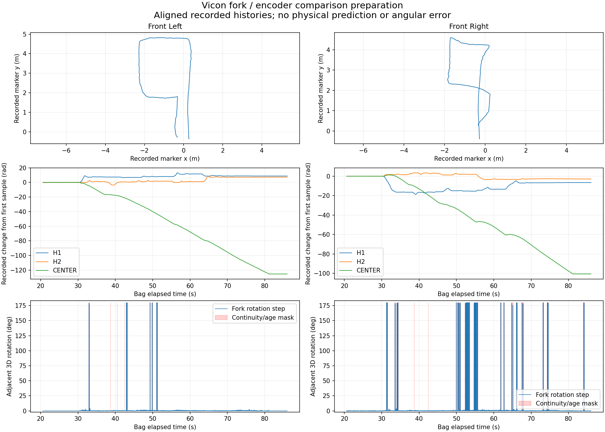

# Vicon fork / encoder comparison preparation

This checked preparation run uses the
[archived analysis exports](../encoder_20261029T065650Z_7f3140ba/README.md)
and the repository's
[comparison configuration](../../../hamr_bringup/config/caster_vicon_comparison.yaml).

[Preparation metadata and quality counts](comparison_setup.json)



The shared encoder interval is 20.590937477–86.028193774 seconds after the
combined bag's exact start epoch `1793256992820270894`. Preparation preserves
7,233 left and 7,215 right native fork observations, pairing each with the last
available base and same-wheel encoder samples. All paired encoder samples pass
the configured age check. It reproduces 8 left and 106 right quaternion jumps
above 10 degrees. Raw orientations are retained; the jump masks identify
discontinuities rather than silently correcting them.

The metadata records verified input hashes, source timing/quality fields,
configuration/script hashes, and missing physical-calibration requirements.
Physical prediction remains unconfigured. Fork motion is not itself a
measurement of CENTER or hemisphere rotation.

To regenerate these artifacts and the two aligned CSV files from the repository
root, without ROS or the original MCAP:

```bash
python3 hamr_bringup/scripts/prepare_caster_vicon_comparison.py \
  docs/analysis/encoder_20261029T065650Z_7f3140ba \
  --config hamr_bringup/config/caster_vicon_comparison.yaml \
  --output-dir "$HOME/hamr_analysis/20261029T065650Z/comparison"
```

The archived metadata retains the workstation paths of this validation run;
its file hashes and repository-relative commands identify the portable inputs.
See the [complete workflow](../../COMBINED_CASTER_ANALYSIS.md) for the required
marker-frame, lever-arm, timing, encoder, and contact-model calibration steps.
