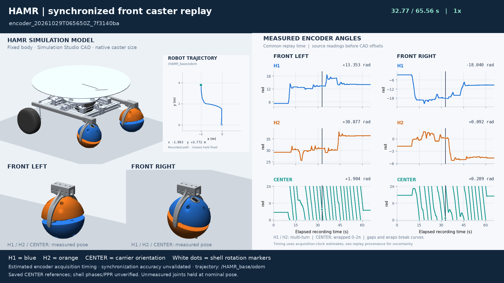

# Combined recording: 20261029T065650Z_7f3140ba

This snapshot preserves the original combined-MCAP analysis and the updated
two-caster simulation preview. The original analysis files are copied byte for
byte. [The manifest](artifact_manifest.json) records their SHA-256 hashes, the
original analysis-script hash, the source MCAP hash, and the bag's exact starting
epoch. The source MCAP and rendered videos remain external recording artifacts.

[Seven-page report](combined_bag_analysis.pdf) ·
[Original analysis notes](analysis_notes.txt) ·
[Numerical summary](summary.json) ·
[Reproduction and comparison workflow](../../COMBINED_CASTER_ANALYSIS.md)

The canonical portable analyzer is
[`analyze_combined_caster_bag.py`](../../../hamr_bringup/scripts/analyze_combined_caster_bag.py).
The original notes and summary retain the workstation paths and reproduction
command from their first analysis; use the portable analyzer and workflow above
for a new run. The archive includes the derived numeric inputs needed to prepare
a Vicon/encoder comparison without loading ROS or the external MCAP.

## Findings in this recording

| Quantity | Observation |
| --- | --- |
| Combined bag | 122.176 s; 394,424 messages; per-topic counts verified |
| Common six-encoder interval | 20.591–86.028 s after bag start; 65.437 s |
| Recorded base motion | Rectangular loop with approach/return; approximately 12.16 m of smoothed travel |
| Encoder continuity | Approximately 200 Hz; no missing sequences or invalid samples reported by the recording export |
| Vicon adjacent orientation changes above 10° during overlap | Base: 0; left fork: 8; right fork: 106 |
| Largest fork orientation changes | Left: 179.884°; right: 179.994° |
| Timing | Encoder acquisition-clock maps are estimated; saved uncertainty fields are approximately 50–99 ms, not validated bounds |

The quaternion-step metric treats `q` and `−q` as the same orientation, so these
large fork steps are not quaternion sign changes or Euler wrapping. Similar
near-180° changes remain relative to the base. Tracking ambiguity is a plausible
explanation, but the cause is not established because individual marker arrays
contain no messages. Fork positions are much more continuous than orientations.

Vicon tracks the fork rigid bodies. CENTER measures an internal carrier rotation
relative to the fork, and H1/H2 measure hemisphere spin. These are different
quantities. Fork orientation cannot be subtracted directly from CENTER or shell
angles to obtain encoder error. A physical comparison still needs reviewed
orientation segments, timing alignment, marker-to-fork calibration, a measured
lever arm to the ball center, verified encoder conventions, and an explicit
kinematic/contact model. The preparation workflow preserves these requirements;
this snapshot makes no ball-orientation prediction or encoder-accuracy claim.

## Report pages

| File | Contents |
| --- | --- |
| [01_overview.png](01_overview.png) | Recorded path, reference route, and motion overview |
| [02_encoder_angles.png](02_encoder_angles.png) | All six encoder angles and accumulated CENTER rotation |
| [03_encoder_rates.png](03_encoder_rates.png) | Encoder rate histories |
| [04_vicon_pose.png](04_vicon_pose.png) | Base, turret, and fork pose histories |
| [05_vicon_quality.png](05_vicon_quality.png) | Quaternion jumps and position continuity |
| [06_drive_response.png](06_drive_response.png) | Commanded/measured drive response and saturation |
| [07_timing.png](07_timing.png) | Recorded timing and clock-estimation diagnostics |

`HAMR_base_pose.csv`, `HAMR_turret_pose.csv`, `Left_Caster_pose.csv`, and
`Right_Caster_pose.csv` retain bag time, source-header time, position, and raw
quaternion components. `encoder_signals.csv` retains source angles and the
descriptive unwrapped change; no CAD sign/phase map is applied to these analysis
exports. `vicon_orientation_jumps.csv` records jump events. `topics.csv` records
the topic inventory and observed timing. `extracted_signals.npz` preserves the
selected decoded numeric channels used by the report.

## Updated replay

The replay uses the same full vehicle CAD as `hamr_sim_ui`, holds the chassis
stationary, and animates both casters on a shared estimated acquisition clock.
Front-left CENTER uses sign −1 about its saved raw reference; front-right uses
its own saved reference. Caster geometry and mounts retain native simulation
dimensions. H1/H2 phase and PPR remain unverified. Source encoder plots preserve
the recorded sign conventions, independently of the replay's CAD mapping.

[Replay encoder plots](replay_encoder_angles.png) ·
[Recorded Vicon base trajectory](replay_trajectory.png)

These images come from the 65.558-second union of the encoder recording. The
65.437-second common-overlap interval used by the analysis is slightly shorter
because the six boards started and stopped at different times. The Vicon inset
uses 7,456 overlapping `/HAMR_base/odom` positions; the analysis pose CSVs use
the separately recorded `/HAMR_base/pose` topic. Their message counts differ.
